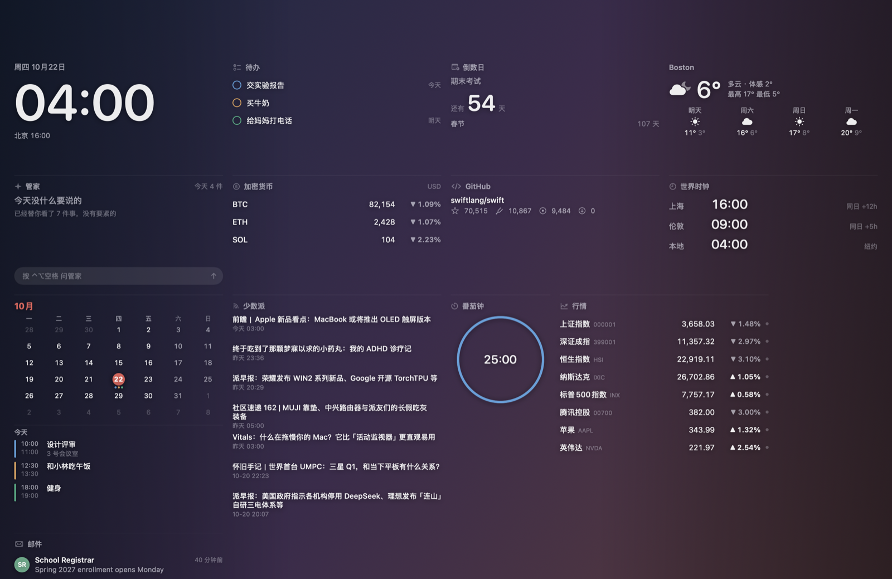

# 一瞥 · Glancedesk

**看一眼 今天的事都在这。** 官网：[glancedesk.cn](https://glancedesk.cn)（原名「桌面信息中心 / DeskHub」）

**一个只在重要时刻说话的桌面（Mac 和 Windows）。** 时钟、天气、日程、行情、邮件安静地铺在壁纸两侧，中间留给你；管家只在真正重要的时候出声。按 `⌃⌥空格` 打开可以操作的那一层。

*A desktop for Mac and Windows that only speaks up when it matters. English below.*




## 特点

- **原生、轻量**：SwiftUI 写的，安装包 6 MB，常驻内存约 50 MB，空闲时 CPU 接近 0。
- **桌面层 + 浮层**：桌面层在壁纸之上、图标之下，只显示不打扰；`⌃⌥空格` 呼出浮层，可以点、可以问、可以改布局。
- **21 种组件，同一种可以加好几个**：时钟、天气、日历、待办（提醒事项）、邮件、行情、新闻、订阅（任意 RSS / Atom）、世界时钟、倒数日、加密货币、GitHub、照片、番茄钟、系统状态、便签、汇率、农历节日、正在播放、管家……每个各自设置（两个行情组件，一个看 A 股、一个看美股）。
- **像 iOS 小组件那样摆**：小 / 中 / 大几档，拖动吸附，自动避让，挪走后被挤开的会自己回去。
- **管家只说重要的事**：「可执行 × 意外」两个维度判断，每天最多打断你一次；谁的邮件重要由你自己定，也可以让 AI 帮你判断。
- **能聊天、能办事**（可选）：填一个 DeepSeek 的 Key，或用本机的 Claude Code。说「把腾讯加进自选」「明早 8 点提醒我交作业」，它列出要做的事，**你点了才执行**。
- **首次引导**：选语言、选身份（学生 / 上班 / 投资 / 极简）就摆好一套。中文、English 都有。
- **主题**：强调色、字号、两侧渐隐浓淡、线条或卡片风格；多显示器每块屏一套布局。
- **自动检查更新**：有新版本时在浮层右上角提示一下（只问 GitHub「最新版本是几号」，不带任何个人信息，不会自动下载安装）。
- **邮箱和日历随你选**：邮件可以读 Mac「邮件」App，也可以直接连 Gmail / iCloud / Outlook / QQ / 163（IMAP + 应用专用密码，只读）；日历可以挑显示哪几个，也能加 Google / Outlook 日历的订阅链接。
- **隐私**：没有账号、没有服务器、不收集任何数据。日历、邮件只读；邮件正文只有你点开或让管家概括时才读。代码全部开源。

## 安装

1. 到 [Releases](../../releases) 下载最新的 `Glancedesk-x.y.z.dmg`，把 App 拖进「应用程序」。
2. **第一次打开会被系统拦下**（这个软件没有付费的 Apple 开发者签名）：打开「系统设置 → 隐私与安全性」，拉到最下面点「仍要打开」。之后就不会再问了。
3. 需要 macOS 14 或更新，Apple 芯片（M1 及以后）。

## Windows 版（预览）

C# / WPF 原生，和 Mac 版同一套组件和布局规则，另外多了两样 Windows 上才需要的：

- **底部 Dock**：像 Mac 那样放常用的应用和文件（下载文件夹点开是一叠最近的文件）。把任何程序、快捷方式、文件拖上去就能放进去，右键挪位置、移除；右端的箭头能收起来，也可以设成自动收起。
- **清空桌面**：一键把桌面图标藏起来，只留壁纸和组件；关掉开关或退出就回来。

安装：到 [Releases](../../releases) 下载 `Glancedesk-Windows-x.y.z-Setup.exe`（不想安装就下 `-portable.zip`，解压直接运行）。**第一次打开 Windows 会弹「已保护你的电脑」**（没有付费的代码签名）：点「更多信息 → 仍要运行」。需要 Windows 10 1809 或更新、64 位；自带运行库，不用另装 .NET。

在 Windows 上：日程用 .ics 订阅链接（Google / Outlook 日历都能导出），邮件用 IMAP，待办存在本机；「正在播放」能看到 Spotify、网易云、QQ 音乐和浏览器里的播放。

## 自己编译

只需要 Xcode 命令行工具（`xcode-select --install`），不需要 Xcode：

```bash
./test.sh                 # 跑测试
./build.sh                # 编译到 build/Glancedesk.app
./scripts/make-dmg.sh     # 出安装包
```

Windows 版在 `windows/` 目录（需要 .NET 8 SDK，Mac 上也能编译和跑测试）：

```bash
dotnet run --project windows/DeskHub.Tests          # 跑测试
dotnet build windows/DeskHub/DeskHub.csproj         # 编译
```

在 Windows 上用 `windows\scripts\build.ps1` 一条命令出安装包。

推一个 `v` 开头的标签，GitHub Actions 会自动测试、编译，把 Mac 和 Windows 的安装包都发布到 Releases。

## 数据来源

行情：新浪财经公开接口（延迟，仅供参考）· 天气：Open-Meteo · 加密货币：CoinGecko · 新闻：各家公开 RSS · 日历 / 提醒事项：系统 EventKit · 邮件：Mac「邮件」App（AppleScript，只读）。都不需要注册。

**本软件只做信息展示和提醒，不构成任何投资建议，不会替你下单。**

---

## English

**Glancedesk** puts your clock, weather, calendar, to-dos, mail, stocks and news quietly on both sides of your wallpaper, and a butler that only speaks up when something really needs you. Press `⌃⌥Space` for the interactive overlay.

- Mail from the Mac Mail app or any IMAP mailbox (Gmail, iCloud, Outlook… read-only, app password); calendars from Mac Calendar or .ics subscription links.
- Native SwiftUI: 6 MB download, ~50 MB memory, near-zero idle CPU.
- 21 widget types, add several of the same kind with their own settings; iOS-style sizes with snapping and auto-arrange.
- Optional AI (bring your own DeepSeek key, or use a local Claude Code): ask questions or say "remind me at 8 tomorrow" — it shows a confirmation card and only acts after you tap Run.
- Apple-style first-run tour, full English and Chinese UI, themes, multi-display layouts, update notifications.
- No account, no server, no tracking. Open source under MIT.

**Install:** download the DMG from Releases and drag the app to Applications. On first launch macOS will block it (no paid Developer ID) — go to System Settings → Privacy & Security and click "Open Anyway". Requires macOS 14+ on Apple silicon.

**Windows (preview):** native C# / WPF with the same widgets and layout rules, plus a Mac-style **Dock** at the bottom (apps, files, a Downloads stack; drag anything onto it, collapse or auto-hide it) and a **clean desktop** switch that hides desktop icons. Download `Glancedesk-Windows-x.y.z-Setup.exe` (or the portable zip) from Releases. SmartScreen will warn on first launch because the app isn't code-signed: click "More info → Run anyway". Windows 10 1809+ (64-bit); no .NET install needed.

**Not investment advice.** Market data is delayed and for display only.

## License

MIT
